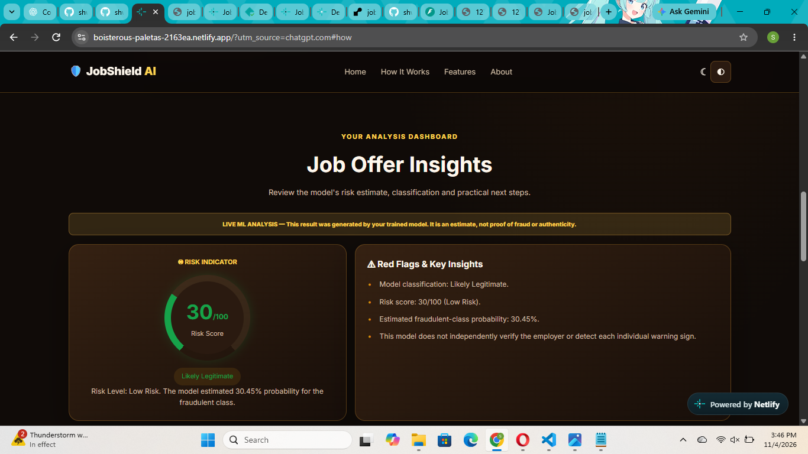

# JobShield AI – AI-Powered Job Scam Detection


JobShield AI is a machine-learning-based web application that analyzes job descriptions and estimates the likelihood of potential job fraud. It helps job seekers identify suspicious patterns before applying.


**Important:** The prediction is an ML-based risk estimate, not proof that a job or employer is genuine or fraudulent.


## Features


- Analyze job descriptions using a trained machine learning model.

- Generate a fraud risk score and classification.

- Display an explanation of the model's prediction.

- Provide a simple, responsive web interface.

- Light and dark themes.

- Demo job description for quick testing.

- FastAPI backend for model predictions.


## Technology Stack


| Component | Technology |

|---|---|

| Frontend | HTML, CSS, JavaScript |

| Backend | Python, FastAPI |

| Machine Learning | Scikit-learn |

| Text Processing | TF-IDF |

| Classification | Logistic Regression |

| Model Storage | Joblib |

| Numerical Processing | NumPy |


## Project Structure


```text

JobShield-AI/
├── backend/
│   ├── main.py
│   └── requirements.txt
├── data/
│   ├── model_evaluation.json
│   ├── preprocessing_report.json
│   └── confusion_matrix.png
├── docs/
├── frontend/
│   ├── assets/
│   ├── index.html
│   ├── script.js
│   └── style.css
├── ml/
│   ├── preprocess.py
│   └── train_model.py
├── models/
│   └── jobshield_model.joblib
├── .gitignore
└── README.md
```


## Machine Learning Model


The project uses a TF-IDF text vectorizer and Logistic Regression classifier.


The model was evaluated on 3,576 test records.


### Evaluation Results


| Metric | Result |

|---|---:|

| Accuracy | 98.77% |

| Precision | 84.13% |

| Recall | 91.91% |

| F1 Score | 87.85% |

| PR-AUC | 95.08% |

| ROC-AUC | 99.24% |


These are results from the project's held-out test set. They do not guarantee the same performance on new or real-world job postings.


## Installation and Setup


### Requirements


- Python 3.11

- pip

- A modern web browser


### 1. Clone the repository


```bash
git clone https://github.com/shwetak20-sys/JobShield-AI.git


cd JobShield-AI

```


### 2. Install backend dependencies


```bash

cd backend

python -m pip install -r requirements.txt

```


### 3. Start the backend


```bash

python -m uvicorn main:app --host 127.0.0.1 --port 8000

```


Backend API:


`http://127.0.0.1:8000`


API documentation:


`http://127.0.0.1:8000/docs`


### 4. Start the frontend


Open another terminal:


```bash

cd JobShield-AI

python -m http.server 5500 --directory frontend

```


Open:


`http://127.0.0.1:5500`


Keep both terminals running while using the application.


## API Endpoint


### POST /analyze


Accepts a job description and returns an ML-based prediction.


Example request:


```json

{

&#x20; "description": "Example job description with company and employment details."

}

```


The response includes:


- Prediction

- Classification result

- Risk score

- Risk probability

- Explanation

- Disclaimer


## Live Demo

- **Live Website:** https://boisterous-paletas-2163ea.netlify.app/
- **GitHub Repository:** https://github.com/shwetak20-sys/JobShield-AI
- **Backend API:** https://jobshield-ai-api.onrender.com
- **API Documentation:** https://jobshield-ai-api.onrender.com/docs


The frontend is hosted on Netlify and the FastAPI backend is hosted on Render.

## Current Limitations


- LinkedIn URL analysis is not implemented.

- The application analyzes supplied job-description text.

- Predictions depend on patterns learned from the training dataset.

- The model cannot independently verify an employer, company registration, or job authenticity.


## Responsible Use


JobShield AI is an assistance tool, not a replacement for independent verification. Always verify the employer, official website, contact details and job offer before sharing personal information or making payments.


## Future Improvements


- Support for additional job datasets.

- Improved model evaluation on diverse real-world job postings.

- Additional fraud-pattern explanations.

- Further improvements to deployment security, monitoring and reliability.

- Optional URL analysis in a future version.


## Author


Developed as an AI/ML portfolio project to explore machine learning, natural language processing, model evaluation and full-stack integration.


## Application Screenshot

### Live ML Analysis

